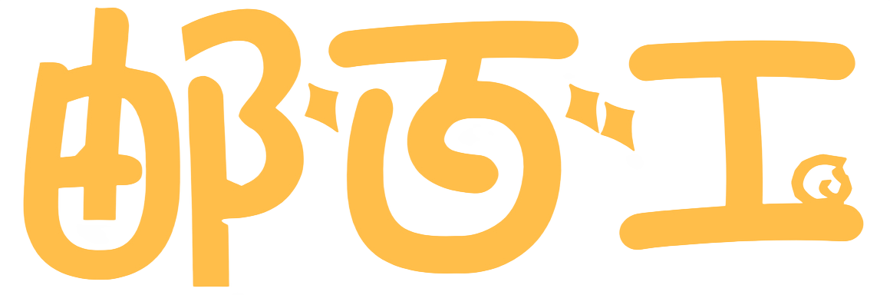

<p align="center">
  
  &nbsp;&nbsp;&nbsp;&nbsp;&nbsp;&nbsp;&nbsp;&nbsp;
  
</p>

<h1 align="center">EngrEduBench</h1>

<p align="center"><b>Engineering Education Competency Assessment Benchmark Dataset</b></p>
<p align="center"><i>工程教育能力评价标尺数据集</i></p>

<p align="center">
  
  
  
  
  
</p>

<p align="center">
  <a href="README_zn.md">简体中文</a> | <b>English</b>
</p>

---

## 📖 Overview

**EngrEduBench** is dedicated to building the industry's first **engineering competency assessment benchmark dataset**. It transforms learning behavior traces from virtual and real-world engineering scenarios into evidence chains of competency, shifting assessment from outcome judgment to process diagnosis and supporting the implementation of high-level engineering competency frameworks.

EngrEduBench is a benchmark dataset for evaluating large language models in engineering education and engineering practice. It is designed to assess whether models can understand behavioral evidence from real engineering learning processes, identify competency signals, assign multi-dimensional scores, and generate explainable diagnostic feedback and improvement suggestions.

The benchmark follows the 11 engineering competency dimensions inspired by the Washington Accord and engineering education accreditation systems. Each dimension contains 3 observable scoring indicators, resulting in 33 fine-grained assessment points.

The dataset is built from **two complementary evidence chains**:

- **Dynamic branch**: structured behavioral evidence extracted from real multi-round "engineer-expert-mentor" collaboration logs across 10 engineering domains, including digital agriculture, smart healthcare, smart manufacturing, information and communication, financial technology, and more.
- **Static branch**: engineering practice records extracted from student project proposal and final reports from Beijing University of Posts and Telecommunications and other educational contexts.

Both branches go through a unified pipeline of "evidence extraction → evidence attribution → multi-dimensional scoring → teacher-supervisor consistency filtering". The current release contains **3,173 high-quality benchmark samples** with scoring reasons and summary comments, plus **480 manually verified golden samples**.

EngrEduBench is still under active construction. The current public release provides 3,000+ high-quality samples. We plan to continuously expand the dataset to **30,000+ samples**, improve evidence coverage, capability attribution, scoring consistency, and golden-set quality, and invite researchers, educators, students, and engineering practitioners to participate in the construction and optimization of this dataset.

> This repository **only releases the dataset**. The internal evaluation pipeline, distillation scripts, and fine-tuning code are not included in this public dataset release.

---

## 🗂️ Repository Structure

```text
EngrEduBench/
├── README.md                          # Chinese README
├── README.en.md                       # English README
├── logo/                              # BUPT & YouBaigong logos
│
├── 工程报告数据集/                       # Static raw data: student engineering reports
│   ├── 立项/                           # 40 proposal reports
│   ├── 结项/                           # 50 final reports
│   └── dataset_static_targeted/        # 10 targeted supplementary reports
│
├── 工程行为数据集/                       # Dynamic raw data: engineering collaboration logs
│   ├── DigitalAgriculture_20/          # Digital Agriculture · 21
│   ├── DigitalEducation_20/            # Digital Education · 20
│   ├── DigitalEntertainment_20/        # Digital Entertainment · 20
│   ├── EnvTech_10/  · EnvTech_10_2/    # Environmental Technology · 10 + 10
│   ├── FinTech_20/                     # Financial Technology · 20
│   ├── InfoComm_20/                    # Information and Communication · 20
│   ├── SmartEnergy_20/                 # Smart Energy · 20
│   ├── SmartHealthcare_20/             # Smart Healthcare · 20
│   ├── SmartManufacturing_20/          # Smart Manufacturing · 20
│   ├── TransportLogistics_20/          # Transportation and Logistics · 20
│   ├── 动态数据集（补）/                  # Supplementary dynamic samples · 20
│   └── dataset_5/                      # Hard-case supplement · 5
│
├── 情境化证据数据集/                     # Evidence extraction results
│   ├── context_extract/                # Context / micro-scenario extraction
│   ├── evidence_extract/               # Atomic evidence extraction
│   │   ├── Interactive-data-evidence/  # Dynamic evidence · 3,454
│   │   ├── static-data-evidence/       # Static evidence · 1,412
│   │   └── 动态数据子集/ · 静态数据子集/ · 600/
│   ├── unified_candidates/             # First candidate pool · 4,000
│   ├── unified_candidates_600/         # Expanded candidate pool · 8,419
│   ├── Interactive_export_manifest.json
│   ├── static_export_manifest.json
│   ├── slice_manifest_targeted.json
│   ├── slice_manifest_inactive+supple.json
│   └── P4_原始候选构造配额方案.md
│
├── 工程能力评价体系数据集/                # Final benchmark dataset
│   ├── engredubench_kept.jsonl         # Main set · 3,173 samples
│   └── engredubench_dropped.jsonl      # Dropped set · 827 samples
│
└── golden-base-data-480-evaluation/    # Manually verified golden set · 480 JSON files
```

---

## 📊 Dataset Scale

| # | Dataset | Size | Role |
| --- | --- | ---: | --- |
| ① | `工程报告数据集` | 100 reports: 40 proposal + 50 final + 10 targeted | Static raw corpus |
| ② | `工程行为数据集` | 226 multi-round collaboration logs across 10 domains | Dynamic raw corpus |
| ③ | `情境化证据数据集` | 12,419 candidates + 4,866 atomic evidence items | Evidence extraction and candidate construction |
| ④ | `工程能力评价体系数据集` | **3,173** kept + 827 dropped | **Final benchmark dataset** |
| ⑤ | `golden-base-data-480-evaluation` | **480** samples | **Manually verified golden set** |

---

## 🎯 11 Engineering Competency Dimensions

| Dimension | Chinese Name |
| --- | --- |
| Engineering Knowledge | 工程知识 |
| Problem Analysis | 问题分析 |
| Design / Development of Solutions | 设计/开发解决方案 |
| Investigation | 研究 |
| Modern Tool Usage | 使用现代工具 |
| The Engineer and the World | 工程与可持续发展 |
| Ethics | 职业规范 |
| Individual and Teamwork | 个人与团队 |
| Communication | 沟通 |
| Project Management | 项目管理 |
| Lifelong Learning | 终身学习 |

Each dimension contains 3 observable indicators, resulting in 33 scoring points. Scores are assigned on a **0–5** continuous ordinal scale (five bands: 0–1 poor / 1–2 weak / 2–3 adequate / 3–4 good / 4–5 excellent). The total score of each dimension is computed using a `0.3 / 0.3 / 0.4` weighted aggregation over the three indicators.
---

## 🧬 Data Format

### Final Benchmark Set `engredubench_kept.jsonl`

The recommended entry point is:

```text
工程能力评价体系数据集/engredubench_kept.jsonl
```

Each line is a JSON object:

```jsonc
{
  "sample_id": "InfoComm_20__22598982_..._008_工程开发_8544a92f6c",
  "manifest": {
    "modality": "dynamic",
    "domain": "InfoComm",
    "stage": "工程开发",
    "evidence_count": "7",
    "quota_group": "InfoComm::工程开发"
  },
  "decision": {
    "flagged_dims": "2",
    "kept": "True"
  },
  "scores": {
    "工程知识": { "score": 4.1, "reason": "观测点1：4.2分 …" },
    "问题分析": { "score": 3.7, "reason": "…" },
    "...": { "score": "...", "reason": "..." }
  },
  "evidence": {
    "工程知识": ["Evidence fragments related to this dimension..."]
  },
  "evaluation": "Overall diagnostic evaluation...",
  "suggestions": "Improvement suggestions..."
}
```

### Golden Set `golden-base-data-480-evaluation/*.json`

Each file is a complete manually verified evaluation sample. Its schema is consistent with the final benchmark set. The golden set can be used as a reference for evaluator calibration, model comparison, prompt optimization, and fine-tuning data validation.

### Dynamic Behavior Data Format

```jsonc
[{
  "domain": "数字农业",
  "stages": [{
    "stageName": "需求与战略",
    "microScenes": [{
      "microScene": "Micro-scenario description...",
      "evidence": [
        { "behaviorLabel": "思考", "behaviorEvidence": "..." },
        { "behaviorLabel": "分析取舍", "behaviorEvidence": "..." }
      ]
    }]
  }]
}]
```

### Static Report Data Format

Static report data follows a similar `domain → stages → microScenes` organization. The `data` field preserves original report text fragments.

---

## 🚀 Quick Start

### Load the Main Benchmark Set

```python
import json

with open("工程能力评价体系数据集/engredubench_kept.jsonl", encoding="utf-8") as f:
    samples = [json.loads(line) for line in f]

print(f"Number of samples: {len(samples)}")
print({d: s["score"] for d, s in samples[0]["scores"].items()})
```

### Load the Golden Set

```python
import json
import pathlib

gold_dir = pathlib.Path("golden-base-data-480-evaluation")
gold = [json.loads(p.read_text(encoding="utf-8")) for p in gold_dir.glob("*.json")]
print(f"Number of golden samples: {len(gold)}")
```

---

## 📐 Recommended Evaluation Metrics

| Metric | Level | Purpose |
| --- | --- | --- |
| **QWK** (Quadratic Weighted Kappa) | Each competency dimension | Measures score agreement |
| **Pearson r** | Each competency dimension | Measures linear score correlation |
| **CosSim** | `evaluation` / `suggestions` text | Measures semantic consistency of diagnostic feedback |

For semantic similarity, we recommend using a strong embedding model suitable for the target language and task context.

---

## 🛠️ Dataset Status and Roadmap

EngrEduBench is an ongoing benchmark construction project.

- Current release: 3,173 kept samples, 827 dropped samples, and 480 manually verified golden samples.
- Planned scale: **30,000+ samples** with broader engineering-domain coverage and stronger quality control.
- Community participation: we welcome data feedback, issue reports, evaluation results, documentation improvements, and ethically shareable engineering learning or practice data.

---

## 🤝 Contributing

We welcome contributions from researchers, educators, students, engineers, and organizations interested in engineering education assessment.

You can contribute by reporting data issues, suggesting improvements to the competency framework, helping review evidence attribution and scoring quality, contributing evaluation results from different models, or improving documentation and examples.

Before contributing new data, please make sure the data is properly authorized, anonymized, and allowed for research use.

---

## 📜 License

This dataset is released under the **Creative Commons Attribution-NonCommercial-ShareAlike 4.0 International License (CC BY-NC-SA 4.0)**.

- ✅ Allowed: academic research, teaching, model evaluation, and derivative work under the same license
- ❌ Not allowed: commercial use or direct resale
- ⚠️ Attribution is required when using or redistributing this dataset

License details: [https://creativecommons.org/licenses/by-nc-sa/4.0/](https://creativecommons.org/licenses/by-nc-sa/4.0/)

---

## 📑 Citation

If EngrEduBench is useful for your research or project, please cite:

```bibtex
@misc{engredubench2026,
  title        = {EngrEduBench: An Engineering Education Competency
                  Assessment Benchmark Dataset},
  author       = {EngrEduBench Team, Beijing University of Posts and Telecommunications},
  year         = {2026},
  howpublished = {\url{https://github.com/<your-org>/EngrEduBench}},
  note         = {Open-source dataset release}
}
```

> 📄 The associated paper (IC12357) has been submitted to IEEE ICCC 2026. The citation entry will be updated after publication.

---

## 🙏 Acknowledgements

EngrEduBench is jointly constructed and released by **Beijing University of Posts and Telecommunications** and **YouBaigong**.

<p align="center">
  
  &nbsp;&nbsp;&nbsp;&nbsp;&nbsp;&nbsp;
  
</p>

We thank all students, teachers, engineers, and domain experts who contributed to data annotation, expert consultation, report organization, and benchmark design.

---

## 📮 Contact

- Issues and feedback: please use [GitHub Issues](../../issues)
- Collaboration or authorization inquiries: please contact the EngrEduBench team through Beijing University of Posts and Telecommunications or YouBaigong

---

**EngrEduBench** · Making engineering capability measurable through evidence-based assessment
